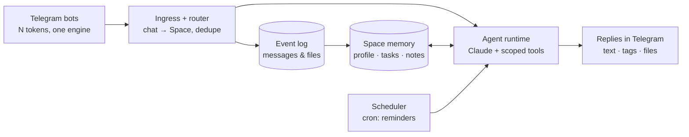

# Sidekick Crew

**A lightweight, safe platform for personal assistants that live inside Telegram group chats.**

One engine, any number of bot identities, any number of chats. Add the bot to a group with your mentee, a client, or your team, and it becomes that chat's assistant: it keeps the plan, records commitments, sets reminders, tags people, answers questions from the chat's own history, and remembers what was decided. Every chat is isolated: the assistant knows only that chat.

Built for one person who runs many parallel relationships (mentoring, clients, projects) and wants an assistant in each of them without building a new bot every time.

## How it works



**Space.** A Space is one Telegram chat plus everything the assistant knows about it: kind (mentoring, client, team, personal), timezone, persona overrides, members and their roles, tasks, reminders, memory notes, and a rolling summary. The bot is the same everywhere; the Space makes it behave differently per chat.

**Personas.** Bot identities are entries in a registry (`src/lib/bots.ts`): a Telegram token, a name, a system prompt. Add a second entry and you have a second bot on the same engine, for example a "pinger" and an "analyst" living in the same group.

**Three layers of memory.**

1. *Event log.* Every message and file, append-only. Source of truth.
2. *Structured state.* Tasks, reminders, decisions, facts about people. The agent writes these itself through tools.
3. *Search.* Postgres full-text search over the log; vector search is a column away when needed.

**Two modes.** Passive: every message is stored and indexed, no model call. Active: a mention, a reply to the bot, a command, or a cron tick triggers the agent, which answers with the full Space context and a set of tools.

## Safety model

The assistant handles other people's conversations, so the boundaries are enforced in code, not in the prompt.

- **Hard chat isolation.** Every tool is bound to the Space of the incoming update inside a closure. The model never passes a chat or Space id, so it cannot read or write another chat even if asked to.
- **Owner-only capabilities.** `/setup` and personal integrations (meeting notes via Granola MCP) attach to a request only when the sender is the configured owner. Everyone else's request is built without those tools, so there is nothing to bypass.
- **Addressing rules that respect humans.** A reply to the bot that tags other people is treated as a message for those people, not for the bot. It is logged, not answered.
- **Idempotent webhook.** Telegram redeliveries are deduplicated by `update_id`; the webhook is protected by a secret token; cron is protected by a bearer secret.
- **Secrets stay in env.** Tokens and API keys live in `.env.local` and Vercel environment variables. The database stores only bot ids.
- **Append-only log, plain-text replies.** History is never rewritten; replies are sent as plain text so nothing is rendered unexpectedly.
- **Auditable.** Every agent invocation is recorded with its input, output, tool calls, and token usage.

## Features

- Mention / reply / DM / `/ask` triggers; `/status` for open tasks; `/id` for user and chat ids.
- Tools: `create_task`, `complete_task`, `set_reminder`, `save_memory`, `list_memories`, `update_memory`, `forget_memory`, `restore_memory`, `search_messages`.
- Reminders fired by cron, tagging the target person.
- Files in: Telegram attachments (PDF, images, docs, spreadsheets) are passed to the model. Files out: the model can produce `.docx`, `.xlsx`, `.pptx`, `.pdf`, `.md` in a sandbox and the bot sends them to the chat.
- Long answers are split for Telegram's 4096-character limit; cut-offs are reported, never silently dropped.
- Owner integration: Granola meeting transcripts via MCP (OAuth device flow, tokens refreshed server-side).
- Prompt caching on the stable persona prefix; server-side refusal fallbacks enabled.

## Stack

Next.js 16 (App Router) · grammY · Drizzle ORM + Neon Postgres · `@anthropic-ai/sdk` (beta tool runner, Zod tools, code execution, Files API, MCP connector) · Vercel (functions, cron, Neon marketplace integration).

## Quick start

1. **Create the bot.** In @BotFather: `/newbot`, then `/setprivacy` → *Disable* so the bot can see group messages.
2. **Database.** `npx vercel link`, then `npx vercel integration add neon` (or create a Neon database and set `DATABASE_URL`).
3. **Env.** Copy `.env.example` to `.env.local` and fill in: `TELEGRAM_BOT_TOKEN`, `TELEGRAM_WEBHOOK_SECRET`, `ANTHROPIC_API_KEY`, `CRON_SECRET`, `APP_URL`. Push the same values to Vercel with `npx vercel env add`.
4. **Schema.** `set -a && source .env.local && set +a && npx drizzle-kit push && npm run db:extra`
5. **Deploy.** `npx vercel deploy --prod`
6. **Webhook.** `npm run webhook:set -- crew`
7. **Owner.** Send `/id` to the bot, put the number into `OWNER_TG_USER_ID`, redeploy.
8. **Add the bot to a group** and run `/setup kind=mentoring tz=Europe/Lisbon persona="..."` as the owner.

The default persona and owner name are in `src/lib/bots.ts`; edit them before deploying your own instance.

## Project layout

```
src/db/schema.ts              spaces, people, space_members, messages, tasks, reminders,
                              memories, processed_updates, agent_runs, integrations
src/lib/bots.ts               persona registry (one entry per Telegram bot)
src/lib/telegram.ts           grammY bots, addressing rules, chunked sending
src/lib/ingest.ts             upserts for space / person / member, event log, dedupe
src/lib/context.ts            renders the Space (members, tasks, memory, recent log) for the prompt
src/lib/agent.ts              Claude tool runner with Space-scoped tools
src/lib/files.ts              Telegram ⇄ Anthropic Files API
src/lib/granola.ts            owner-only Granola MCP with OAuth refresh
src/app/api/telegram/[botId]  webhook (ack first, process with waitUntil)
src/app/api/cron/tick         reminder dispatcher
scripts/                      set-webhook, db-extra, granola-auth
```

## Roadmap

- Passive classification of every message with a small model: commitment / task / file / noise → auto-recorded without a mention.
- Rolling Space summary and weekly digests.
- Space templates (mentoring, client, team) stored as JSON; a second persona.
- Admin UI: spaces, templates, agent run log.
- File text extraction and vector search over chat documents.
- Per-chat guard for owner integrations (only meetings whose participants overlap with the group).

## Status

Early, in daily use by its author. Expect rough edges. Issues and ideas welcome.
